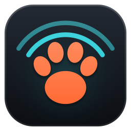
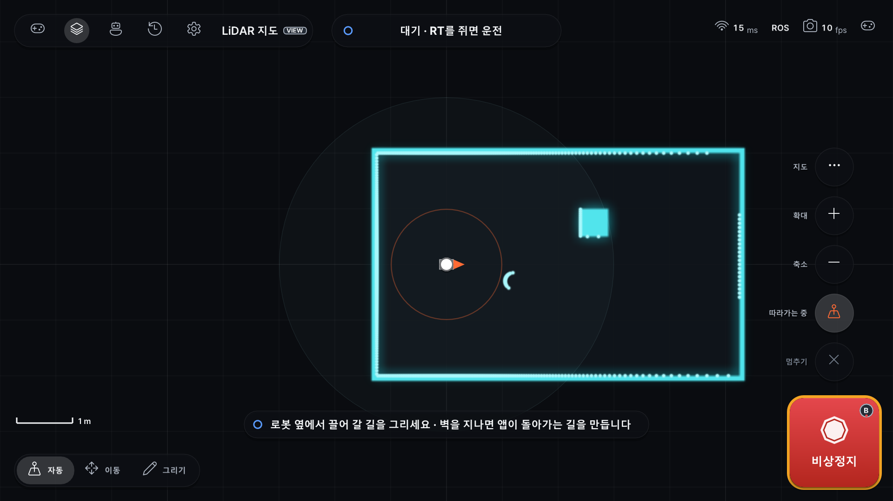
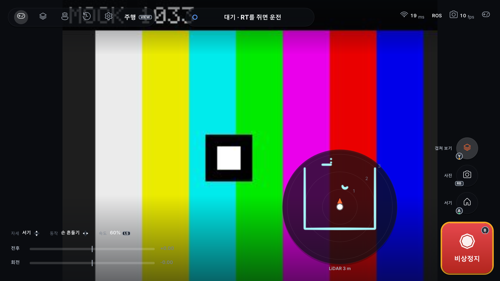
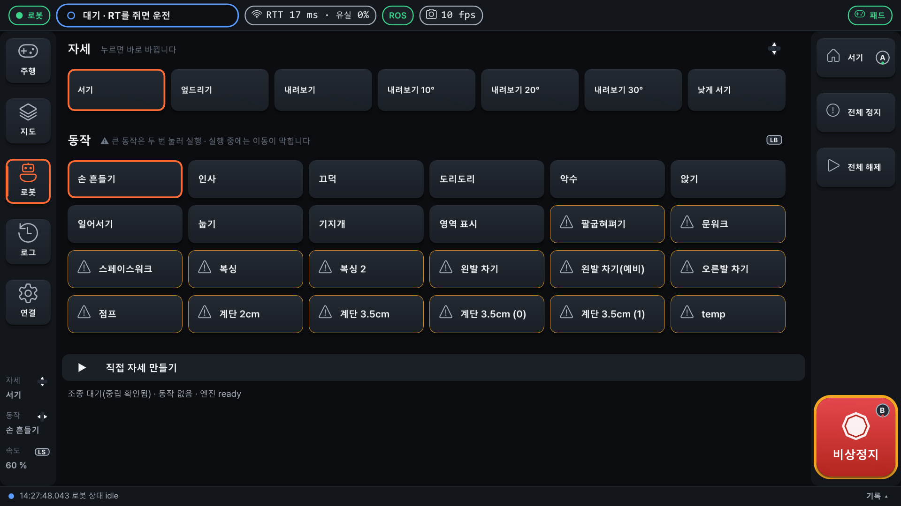
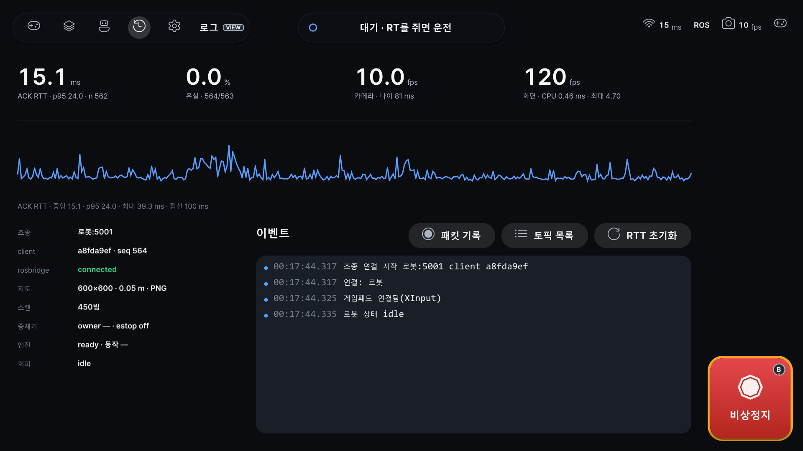
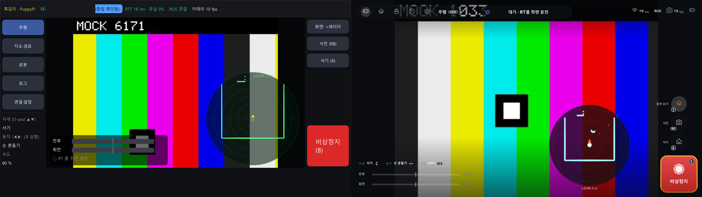

#  puppypi_heukgalli

[](https://github.com/Ksyear/puppypi_heukgalli/actions/workflows/ci.yml) [](https://github.com/Ksyear/puppypi_heukgalli/releases)

**ROG Ally X 를 Hiwonder PuppyPi 전용 핸드헬드 리모컨으로 쓰는 C++ 클라이언트 앱.** 스틱·트리거로 데드맨 주행을 하고, 손가락으로 LiDAR 지도에 길을 그리면 앱이 장애물을 피하는 경로로 바꿔 보낸다. 카메라와 LiDAR 레이더는 120 Hz 터치 화면에 띄운다. 로봇 소프트웨어는 한 줄도 바꾸지 않는다.

> **English summary.** A Win32 + Direct3D 11 + Dear ImGui 1.93.0 client for a Hiwonder PuppyPi running a team-written ROS 2 stack, built for the ASUS ROG Ally X handheld ("heukgalli", the author's black Ally X on Windows 11). It speaks only the robot's published network interfaces (UDP Protocol v2, rosbridge WebSocket, HTTP MJPEG/JSON); no Hiwonder or team code is included and the robot software is unchanged. Single static exe built with MinGW-w64 (GCC 16.2 on the Ally, cross-compiled on macOS and in CI). The map screen renders the robot's LiDAR occupancy grid (`/map`) with live scans and plans around obstacles on the app side (A* with robot-size inflation, re-planning when the live scan blocks the path), because the robot itself has no obstacle avoidance. Core unit tests (99 checks) pass on macOS, on the Ally and in GitHub Actions (Ubuntu 24.04); every push also runs the mock-robot integration scripts (drive: 14 expects, obstacle avoidance: 8 expects, emergency stop with the first two stop packets dropped) and a Windows cross build. **Status: runs on the Ally; not yet tested with the real robot.** Hardware testing is tracked in `docs/HW_TEST_CHECKLIST.md`.

---

## 현재 상태 (2026-11-15)

| 항목 | 상태 |
|---|---|
| 코어 단위 시험 | 99개 통과. macOS clang, 흑갈리 MinGW GCC 16.2(2026-11-16 다시 확인), GitHub Actions Ubuntu 24.04(푸시마다) |
| 가짜 로봇 통합 시험 | 주행 `tests/it_drive.txt`(expect 14개), 장애물 회피 `tests/it_avoid.txt`(expect 8개), 비상정지 유실 `tests/it_estop_loss.txt` 모두 통과. 맥, GitHub Actions(푸시마다) |
| 흑갈리 → 맥 가짜 로봇 (Tailscale) | `it_drive` 통과. `it_avoid` 는 Tailscale 이 중계(DERP)로 바뀐 때 UDP 유실 25–56 % 로 로봇 watchdog(0.4 s)이 경로를 취소해 3개 실패했다. 설계대로 멈춘 것이며 실제 LAN 에서 다시 확인해야 한다 |
| Windows exe | 맥 교차 빌드, GitHub Actions 교차 빌드, 흑갈리 자체 빌드(`build.ps1`) 모두 성공, 경고 0. 아이콘·매니페스트 포함 |
| 흑갈리에서 실행 | **확인함(가짜 로봇에 연결).** 다섯 화면 표시, 내장 패드(XInput) 인식, 화면 120 fps(2026-11-14, 전원 상태 미기록)·배터리에서 93–116 fps(2026-11-15), 프레임당 CPU 평균 0.6–1.2 ms([측정 기록](docs/MEASUREMENTS.md)). 진동·터치 스케치·기울기는 아직 사람이 확인하지 않았다 |
| 배포 | [v0.1.0](https://github.com/Ksyear/puppypi_heukgalli/releases/tag/v0.1.0) 사전 릴리스(2026-11-14, Windows x64 zip). 앱 아이콘은 다음 릴리스부터 들어간다 |
| 실제 로봇 시험 | **아직 안 함.** 사용자가 [`docs/HW_TEST_CHECKLIST.md`](docs/HW_TEST_CHECKLIST.md) 로 수행한다 |

가짜 로봇 시험 통과는 실기 검증이 아니다. 아래의 "동작한다" 는 서술은 모두 코드와 가짜 로봇 기준이다.

## 화면

흑갈리(ROG Ally X)에서 앱이 직접 저장한 1920×1080 화면이다(F12). **가짜 로봇(`tools/mock_robot.py`)에 연결한 상태**라 카메라는 시험 패턴이고 지도는 가상의 방이다. 주소는 `--privacy` 모드로 가렸다.

| LiDAR 지도 — 점유 격자, 실시간 스캔, 그린 길 → 장애물 회피 경로 | 주행 — 전면 카메라, LiDAR 레이더, 주행 상태 캡슐 |
|---|---|
|  |  |
| **로봇 — 자세 7개, 동작 24개(⚠ 큰 동작은 두 번)** | **로그 — ACK RTT, 유실, 카메라, 화면 fps** |
|  |  |

디자인 변천(왼쪽: 첫 버전의 기본 ImGui 룩, 오른쪽: "검은 유리 조종석" v2 — 콘텐츠를 화면 전체에 깔고 조작은 떠 있는 유리 조각으로만). 조사·결정 과정은 [`docs/DESIGN_PLAN_v1.md`](docs/DESIGN_PLAN_v1.md), [`docs/DESIGN_PLAN_v2.md`](docs/DESIGN_PLAN_v2.md).



<!-- TODO: 실제 로봇 장면 GIF(실기 시험 뒤) -->

더 읽을 것: [아키텍처](docs/ARCHITECTURE.md) · [코드 둘러보기](docs/CODE_TOUR.md) · [측정 기록](docs/MEASUREMENTS.md) · [실기 점검표](docs/HW_TEST_CHECKLIST.md) · [문서 목록](#문서)

## 내려받기와 실행

1. [Releases](https://github.com/Ksyear/puppypi_heukgalli/releases) 에서 `puppypi_heukgalli-<버전>-windows-x64.zip` 을 받아 아무 폴더에 푼다. 설치는 없다. `puppypi_heukgalli.exe` 와 `fonts\` 를 같은 폴더에 둔다.
2. 흑갈리와 로봇을 **같은 Wi-Fi** 에 연결한다. 로봇에서는 팀 ROS 2 스택이 실행 중이어야 한다(쓰는 포트: [아키텍처 §5](docs/ARCHITECTURE.md#5-로봇-포트와-엔드포인트)).
3. exe 를 실행하고 연결·설정 화면에서 "같은 Wi-Fi 에서 찾기" 를 누르거나 IP 를 직접 넣는다. 처음에는 "최고 속도 비율" 을 낮춰 두는 것이 좋다.

확인한 환경은 ROG Ally X, Windows 11 Home 하나다.

| 옵션 | 뜻 |
|---|---|
| (없음) | 테두리 없는 전체 화면. **F11** 로 창 모드와 전환, **F12** 로 화면 저장(`shots\ui_*.bmp`, IP 는 항상 가려서 저장) |
| `--windowed` | 처음부터 창 모드 |
| `--privacy` | 화면에서 IP 주소를 가린다(스크린샷·녹화용) |
| `--kbdrive` | 패드가 없는 PC 에서 Shift 를 쥔 동안만 W/A/S/D 로 운전(개발·시연용) |

설정은 exe 옆 `config.json`, 사진은 `shots\cam_*.jpg` 에 저장된다. 마지막으로 연결한 주소가 있으면 시작과 함께 자동으로 연결한다.

**주의**: 서명하지 않은 exe 라 Windows Smart App Control 이 켜져 있으면 실행이 막힌다(앱별 예외가 없다). 작성자는 개발용 기기에서 이 기능을 끄고 실행했다. 한번 끄면 Windows 업데이트에 따라 다시 켜기 어려울 수 있으니 끄기 전에 확인할 것.

## LiDAR 지도와 장애물 회피

로봇의 경로 추종기는 경유점(지도 좌표, 최대 20개)을 차례로 따라갈 뿐 장애물을 피하지 않는다. 그래서 회피는 앱이 맡는다(`src/planner.*`, `Robot::nav_loop`).

1. **지도**: 로봇 지도작성 노드의 `/map`(600×600, 5 cm, 2 s 마다)을 rosbridge 로 받는다. 큰 메시지라 PNG 압축으로 받고(가짜 로봇 기준 1.4 MB → 약 10 KB), 정수 배열은 일반 JSON 해석기를 거치지 않고 직접 읽는다. 앱이 점유 칸(빛나는 청록)·빈 칸·모르는 칸을 직접 그리고, `/lidar_map/pose`(10 Hz)와 `/scan` 을 겹쳐 그린다.
2. **보내기 전**: 손가락으로 그린 선을 경유점으로 단순화한 뒤, 0.10 m 격자에 지도 점유 칸과 실시간 스캔 점을 올려 로봇 크기만큼(0.20 m) 부풀린다. 막힌 구간만 A*(8방향, 벽 가까이는 비싸게)로 돌아가고, 보이는 데까지 건너뛰어 꺾이는 점만 남겨 20개 이하로 줄인다. 그린 선이 벽을 지나는 구간은 빨간 점선으로 보여 준다.
3. **가는 중**: 새 스캔마다 남은 경로 앞쪽 1.6 m 를 감시한다. 장애물이 4번 중 3번 잡히면 `path_cancel` → 막힌 점을 20 초 기억 → 현재 위치에서 남은 경유점까지 다시 계획 → 로봇이 중립으로 돌아오면 새 경로를 보낸다.
4. **막혔을 때**: 돌아갈 틈이 없으면 멈춘 채 "우회 경로 없음 — 다시 그려 주세요" 를 띄운다. 사용자가 스틱을 쓰거나 비상정지하면 회피 주행은 즉시 끝난다.

## 왜 Ally X 인가

| Ally X 특성 | 로봇 리모컨에서의 의미 |
|---|---|
| Xbox 배치 패드(스틱 2, 아날로그 트리거 2, 범퍼 2, D-pad, ABXY) | 아날로그 전·후진/회전과 "쥐고 있을 때만 움직이는" 데드맨(RT)을 손을 떼지 않고 구현 |
| 럼블 모터 | 화면을 안 봐도 명령 거절·비상정지·연결 끊김·경로 도착을 손으로 안다 |
| 120 Hz 터치 화면(1920×1080 가로 기준으로 UI 설계) | 카메라 원본 비율 표시, 손가락 경로 스케치, 엄지 도달 범위 안의 큰 버튼 |
| 내장 가속도계 | 기울임 조향 옵션(Windows Sensor API, 실기에서 노출 여부 미확인) |
| Wi-Fi·배터리·한 손 크기 | 로봇 옆을 걸어다니며 조종. 노트북 + 조이스틱 조합을 대체 |
| Windows 11 | Win32·D3D11·XInput 을 그대로 쓰는 단일 exe, 설치 없음 |

## 기능표: 로봇 기능 → 흑갈리 입력·화면

로봇 쪽 인터페이스는 모두 팀 ROS 2 스택이 이미 제공하는 것이다. 앱은 그 클라이언트일 뿐이다.

| 로봇 인터페이스 | 앱 기능 | 흑갈리 입력 / 화면 |
|---|---|---|
| UDP 5002 발견 `PUPPYPI_DISCOVER/1` | 같은 LAN 의 로봇 찾기(nonce 검증) | 연결·설정 화면 "같은 Wi-Fi 에서 찾기" → 목록 터치 |
| 수동 IP | 화면 숫자 패드로 입력, `config.json` 에 기억, 시작 시 자동 재연결 | 연결·설정 화면 "연결" / "끊기" |
| UDP 5001 v2 `command` 20 Hz | 데드맨 주행(전·후진, 회전), 속도 비율 | LS Y + RS X, RT 홀드. LT 정밀, LS 클릭 속도 토글 |
| v2 중립 확인 규칙 | 연결 직후·타임아웃 뒤 중립을 보내 `idle` 확인 후에만 주행 | 자동. 주행 상태 캡슐 |
| v2 `emergency_stop` | 비상정지(2회 송신) + 아래 rosbridge 전체 정지를 함께 | **B**, 또는 모든 화면 오른쪽 아래 빨간 "비상정지" 버튼 |
| v2 `clear_emergency` | 해제(1 초 길게 누르기) → 재프레스 요구 | 같은 버튼이 "해제 · 1초 누르기" 로 바뀜(터치 전용) |
| v2 `disconnect` | 중립 1회 + disconnect, UUID 폐기 | 앱 종료, 연결·설정 화면 "끊기" |
| v2 ACK(8필드 엄격 파싱) | 상태·거절 사유·비상정지 latch 표시, RTT·유실률, 럼블 | 주행 상태 캡슐, 로그 화면, 진동 |
| v2 `path` / `path_cancel` | 지도 위 손가락 스케치 → 단순화 → 막힌 구간 A* 우회 → ≤20점 전송, 가는 중 막히면 다시 계획 | 지도 화면 드래그 → "보내기 · N점 · L m". **X** 또는 "멈추기" |
| rosbridge `/map`(`compression:"png"`) | LiDAR 점유 격자 지도를 앱이 직접 그림, 경로 계획의 장애물 | 지도 화면(−/+ 확대, "로봇 보기") |
| rosbridge `/lidar_map/pose`(10 Hz) | 지도 위 로봇 위치·방향, 지나온 길 | 지도 화면 |
| rosbridge `/scan`(10 Hz) | LiDAR 레이더(반지름 3 m, 1 m 링, 전방 위), 지도 위 실시간 스캔 점, 회피 감시 | 주행 화면. **Y** 로 카메라 / 카메라+레이더 / 레이더만 |
| rosbridge `/puppy_control/go_home` | 서기(홈) | **A**(RT 를 쥐지 않았을 때), 주행·로봇 화면 "서기" |
| rosbridge `/puppy_control/runActionGroup` | 동작 그룹 24개(`2_legs_stand` 제외). 큰 동작 14개는 2 초 안에 두 번 눌러야 실행 | 로봇 화면 격자, 또는 D-pad ◀▶ 선택 + **LB** |
| rosbridge `/puppy_control/pose` 발행 | 자세 프리셋 7개 + 직접 만들기(roll/pitch/yaw/height/x_shift/stance/run_time) | 로봇 화면, 또는 D-pad ▲▼(0.3 초 멈춘 자세만 전송) |
| rosbridge `/puppy_control/emergency_stop`·`reset_estop` | 로봇 전체 latch 정지/해제 | 비상정지 버튼·B 가 v2 와 함께 건다. 해제는 `reset_estop` 완료 뒤 v2 `clear_emergency` |
| rosbridge `/lidar_mapper/save_map`·`reset_map` | 지도 저장 / 새로 시작("정말 새로?" 로 한 번 더 확인) | 지도 화면 |
| rosbridge `/puppy_control/status`, `/arbiter_state` | 동작 실행 중·이동 차단 표시 | 주행 상태 캡슐, 로봇 화면 |
| rosbridge `/rosapi/topics` | 연결 진단 | 로그 화면 "토픽 목록" |
| HTTP 8080 카메라 MJPEG | 주행 화면 배경, fps·프레임 나이, 2 초 넘게 오래되면 회색 처리 | 주행 화면. 설정에서 끄기 가능 |
| (카메라 스트림의 최신 프레임) | 정지 사진을 `shots\cam_*.jpg` 로 저장 | **RB**(기울임 조향이 꺼져 있을 때), "사진" 버튼 |
| HTTP 8090 `/api/path` | 경로 상태 idle/rotate/drive/blocked/done/cancelled, 1 Hz(이동 중 4 Hz) | 주행·지도 화면 진행 표시, 럼블 |
| HTTP 8090 `/api/map` | `/lidar_map/pose` 가 1.5 s 넘게 없을 때 로봇 위치 대체원, 1 Hz | 내부 |
| HTTP 8090 `/api/status` | rosbridge 가 끊겼을 때 중재기 상태 대체원, 2 Hz | 내부 |
| Ally 가속도계 | 기울임 조향(기본 꺼짐, RB 를 쥔 동안만, 쥐는 순간 자세가 0) | 연결·설정 화면 토글 |

## 게임패드 배치

| 입력 | 기능 | 비고 |
|---|---|---|
| 왼쪽 스틱 Y | forward −1..1 | 원형 데드존 0.12(설정 0.05~0.4), 지수 곡선 1.5 |
| 오른쪽 스틱 X | turn −1..1 (오른쪽 = 우회전) | "왼쪽 스틱 하나로 운전" 옵션이면 LS X |
| **RT ≥ 50 %** | **데드맨.** 쥐고 있을 때만 `control_active:true`. 놓으면 즉시 중립 | 더 깊게 쥘수록 빠름(50 % → 100 %) |
| LT ≥ 50 % | 정밀 모드 ×0.4 | |
| A | go_home(서기) | RT 를 쥐고 있으면 무시 |
| **B** | **비상정지**(v2 + rosbridge 전체 정지) | 어느 화면에서나. 해제는 터치 전용 |
| X | 경로 멈추기(취소) | |
| Y | HUD 레이어 순환(카메라 → 카메라+레이더 → 레이더만) | |
| D-pad ▲▼ | 자세 프리셋 순환, 0.3 초 뒤 자동 발행 | RT 를 쥐고 있으면 발행 안 함 |
| D-pad ◀▶ | 동작 그룹 선택 | 큰 동작은 노랑 |
| LB | 선택한 동작 그룹 실행 | 큰 동작은 2 초 안 두 번. RT 를 쥐고 있으면 무시 |
| RB | 사진 저장. 기울임 조향이 켜져 있으면 RB 홀드 중 기울기로 운전 | |
| LS 클릭 | 최고 속도 100 % ↔ 설정값(기본 60 %) | |
| RS 클릭 | 없음 | |
| View | 화면 전환 주행 → 지도 → 로봇 → 로그 | |
| Menu | 연결·설정 화면 ↔ 주행 | 연결·설정 화면에서는 운전하지 않음 |
| View + Menu 1.5 초 | 앱 종료 | |
| 키보드 | `--kbdrive` 로 켰고 패드가 없을 때만, Shift 를 쥔 동안 W/S/A/D(0.6 배) | 개발·시연용. F11 전체 화면 전환, F12 화면 저장 |

M1/M2 뒷면 버튼은 Armoury Crate 설정에 따라 XInput 으로 보이지 않을 수 있어 매핑하지 않았다.

## 안전 모델

로봇이 움직이는 조건은 매 50 ms 송신 주기마다 순수 함수 `decide_drive()` 가 다시 판단한다(`src/v2client.cpp`, 단위 시험 대상). 활성 명령(`control_active:true`)은 **아래 전부가 참일 때만** 나간다. 나머지 경우는 모두 중립(`control_active:false, forward:0, turn:0`)이다.

1. **데드맨**: RT ≥ 50 %(또는 RB 기울임, `--kbdrive` 의 Shift)를 쥐고 있고 스틱이 0 이 아니다.
2. **입력 신선도**: UI 스레드가 최근 **0.25 s** 안에 입력을 넘겼다. 화면이 멈추면 중립.
3. **포커스**: 창이 활성(`WM_ACTIVATEAPP`), 최소화·가려짐(DXGI occluded) 아님, 연결·설정 화면 아님. 포커스를 잃는 순간 `set_drive(0,0,false)` 를 바로 호출한다. 포커스가 없으면 멈추는 버튼(B, X) 말고는 패드 버튼도 받지 않는다(XInput 은 포커스와 상관없이 입력을 준다).
4. **ACK 신선도**: 로봇 ACK 가 최근 **0.6 s** 안에 왔다. 로봇 쪽 watchdog(0.4 s)이 먼저 멈추고, 앱은 그 뒤 중립으로 돌아간다.
5. **로봇 상태**: 마지막 ACK 의 `state` 가 `idle` 또는 `active`. `awaiting_neutral`·`timeout` 이면 중립을 보내며 확인을 기다리고, 로봇이 `idle` 을 돌려주면 자동 재개한다.
6. **비상정지 없음**: 앱이 비상정지를 요청한 상태도, ACK 의 `emergency_stop` latch 도 아니다.
7. **재프레스 규칙**: 비상정지 해제 직후에는 `release_required` 가 켜진다. 데드맨을 **한 번 놓아야** 풀리고, 놓기 전까지는 쥐고 있어도 움직이지 않는다.

**비상정지(B 또는 빨간 버튼)** 는 v2 `emergency_stop` 을 두 번(번호를 올려) 보내고, 동시에 rosbridge `/puppy_control/emergency_stop` 으로 로봇 전체 latch 도 건다. 그 뒤 ACK 에 latch 가 보이지 않으면(비상정지 패킷이 모두 유실) 요청을 지우지 않고 0.2 s 마다 다시 보낸다. 비상정지 요청은 사용자의 해제로만 풀린다. 긴 진동 0.6 s. **해제**는 터치 전용으로 1 초 길게 눌러야 하며, rosbridge `reset_estop` 완료 콜백 뒤에 v2 `clear_emergency` 를 보낸다(순서는 팀 로봇 문서 06 §3 의 latch 관계에 따름). 그 뒤 재프레스 규칙이 적용된다.

**로봇 쪽 뒷받침**: 단일 조종자(UUID + 주소, lease 1.0 s), watchdog 0.4 s, 활성 명령 전 중립 확인, 비상정지 latch 는 조종자만 해제, disconnect 한 UUID 재사용 불가. 앱이 죽거나 Wi-Fi 가 끊겨도 로봇은 0.4 s 안에 스스로 멈춘다. 앱 종료 시에는 중립 1회 + `disconnect` 를 보내 소유권을 즉시 반납하고 다음 연결은 새 UUID 를 쓴다.

**손으로 아는 상태**(럼블): 짧게 = 수락·동작 시작·사진, 두 번 = 거절(`not_owner`, `neutral_required` 등, 1 초에 한 번)·연결 끊김·경로 취소/차단, 길게 = 비상정지, 두 박자 = 경로 도착.

## 아키텍처

`src/` 코어(json·util·sock·net·rosbridge·v2client·discovery·path_tools·image_decode·lidar·planner·robot)는 표준 라이브러리와 소켓만 쓰는 크로스플랫폼 코드로, `sock.hpp` 한 곳에서 Winsock/POSIX 를 덮는다. `src/win/` 은 Win32 창·D3D11·ImGui·XInput·Sensor API 를 다루는 Windows 전용 층이다. 화면 스레드는 매 프레임 `Robot::snapshot()` 을 한 번 복사해 읽기만 하고, 로봇을 움직이는 요청은 메서드 호출로 넘긴다. 실제 송신은 v2 송신 스레드(20 Hz) 한 곳에서만 한다. JSON 파서, WebSocket 프레이밍, MJPEG 분리, 경로 단순화, A* 계획은 외부 의존성 없이 직접 구현했다(UI 는 Dear ImGui, JPEG·PNG 디코드는 stb_image).

스레드 구성(UI 120 Hz, v2 송신 20 Hz + 수신, rosbridge, HTTP 폴러, 회피 10 Hz, MJPEG + JPEG 디코더, 지도 텍스처 작업, 기울기 센서), v2 클라이언트 상태 규칙, 회피 순서, 로봇 포트·엔드포인트는 **[docs/ARCHITECTURE.md](docs/ARCHITECTURE.md)** 에 Mermaid 다이어그램으로 정리했다.

## 빌드

CMake 없이 `Makefile` 하나와 PowerShell 래퍼로 두 플랫폼을 다룬다. C++17.

### macOS (코어 시험, 교차 빌드)

```sh
make test                                  # clang++, 단위 시험 빌드·실행 → build/test_core
make console                               # 텍스트 클라이언트 → build/console
make CROSS=x86_64-w64-mingw32- BUILD=build-win app   # Windows exe 교차 빌드 → build-win/puppypi_heukgalli.exe
```

교차 빌드에는 `x86_64-w64-mingw32-g++`·`windres` 가 PATH 에 있어야 한다. 결과는 `-static -static-libgcc -static-libstdc++` 로 링크한 단일 exe(의존 DLL 없음)다. 스택 보호·FORTIFY·CET·ASLR/DEP 를 켜고, 아이콘과 매니페스트(UTF-8 코드페이지, PerMonitorV2 DPI)는 `src/win/app.rc` 로 넣는다. 툴체인이 몰래 붙이는 기본 매니페스트는 빼서 매니페스트가 하나만 남게 한다(`Makefile` 주석).

### 흑갈리 (Windows 11, 폴더 안 툴체인)

1. WinLibs MinGW-w64 GCC 16.2 UCRT 를 `toolchain\mingw64\` 에 풀어 둔다(시스템 설치·PATH 변경 없음, `.gitignore` 대상).
2. Git for Windows 가 `C:\Program Files\Git\usr\bin\sh.exe` 를 제공해야 한다(Makefile 의 `mkdir -p`·`rm -rf` 용).
3. PowerShell:

```powershell
.\build.ps1          # 앱 → build\puppypi_heukgalli.exe
.\build.ps1 test     # 코어 단위 시험
.\build.ps1 run      # 빌드 후 실행
```

글꼴은 exe 옆(또는 저장소 루트) `fonts\` 의 Pretendard Std 를 쓰고, 거기 없는 한글은 맑은 고딕, 아이콘은 Segoe Fluent Icons, 숫자는 Consolas 를 실행 시 시스템에서 읽는다(시스템 글꼴은 재배포하지 않는다). `fonts\` 가 없으면 맑은 고딕으로 대신한다.

앱 아이콘(`src/win/app.ico`, 16–256 px 10장)은 `python3 tools/make_icon.py` 가 의존성 없이 그린다.

### CI

[`.github/workflows/ci.yml`](.github/workflows/ci.yml) 이 푸시·PR 마다 Ubuntu 24.04 에서 단위 시험 → 콘솔 빌드 → 가짜 로봇 자체 시험 → `it_drive` → `it_avoid` → 비상정지 유실 시험을 돌리고, MinGW-w64 교차 빌드한 exe 를 아티팩트로 올린다.

## 테스트

### 단위 시험 (`tests/test_core.cpp`, 외부 프레임워크 없음)

`make test` → **99 checks pass** (macOS clang, 흑갈리 `.\build.ps1 test`, CI Ubuntu 24.04).

- 프로토콜·안전: ACK 8필드 엄격 파싱, `decide_drive()` 전이 표(중립 확인·데드맨·입력 정지·ACK 끊김·비상정지·timeout 자동 재개·재프레스), 발견 응답 nonce/형식 검증
- 파서·도구: JSON 왕복·깊이 제한·정수/실수 출력, `/api/map`·`/api/path`·`/scan` 파서, UUID/base64/문자열 도구
- 지도: 지도 픽셀↔미터 변환, 점유 격자 빠른 해석, 쿼터니언→yaw, 스캔→지도 좌표, RDP 스케치 단순화(직선→2점, L→3점, 지그재그→≤20점)
- 계획기: 직선 막힘 우회, 벽 틈 통과, 완전히 막힘 실패, 경유점이 장애물 안이면 실패, 점유 격자 지도 기반 우회, 앞쪽 감시 범위, 막힘 판정(4번 중 3번·쿨다운), 남은 경유점 계산, 얇은 벽에 붙어 출발해도 벽을 뚫지 않음(0.05–0.15 m)

### 통합 시험 (가짜 로봇)

```sh
git clone https://github.com/Ksyear/PuppyPI_Cpp_ROS2   # 가짜 로봇이 규칙을 빌려 오는 로봇 저장소
export PUPPYPI_ROBOT_SRC=$PWD/PuppyPI_Cpp_ROS2/ros2_ws/src/puppy_vr_bridge
python3 tools/mock_robot.py &                     # UDP 5001/5002, TCP 8080/8090/9090 을 127.0.0.1 에 연다
./build/console --host 127.0.0.1 --script tests/it_drive.txt
./build/console --host 127.0.0.1 --script tests/it_avoid.txt   # 가짜 로봇을 새로 띄운 뒤
```

- `tests/it_drive.txt`(expect 14개): 연결 → 중립 확인 → 주행 → 놓기 → go_home → 자세 → 동작 그룹 → 경로 전송(rotate→drive→done) → 스틱 개입으로 경로 취소 → 비상정지 → 해제 → 지도 저장/새로 → 토픽 목록 → RTT 수집. 실패가 있으면 종료 코드 1.
- `tests/it_avoid.txt`(expect 8개): 경로 위에 미리 놓인 장애물을 피해 도착하고, 가는 중에 경로 위에 생긴 장애물을 스캔으로 찾아 다시 계획해 도착한다. 두 경우 모두 가짜 로봇의 충돌 기록이 없어야 한다.
- `tests/it_estop_loss.txt` + `tools/lossy_udp_proxy.py`: 앱과 가짜 로봇 사이에서 비상정지 UDP 처음 두 개를 버린다. 앱이 비상정지를 다시 보내 로봇이 latch 되어야 통과한다. 중계기는 다른 루프백 주소(리눅스 `127.0.0.2`)를 쓰므로, 맥에서는 다른 로컬 주소로 `--listen` 을 바꿔 돌린다.

`tools/mock_robot.py` 는 Python 표준 라이브러리로 만든 **시험 보조 도구**다(앱 자체는 C++). 실행 시 `--robot-src`(또는 `PUPPYPI_ROBOT_SRC`)가 가리키는 [로봇 저장소](https://github.com/Ksyear/PuppyPI_Cpp_ROS2)의 프로토콜 모듈(`protocol_v2.py`, `path_follower.py`)을 import 해서 조종 규칙의 기준으로 쓴다. 로봇 코드는 이 저장소에 복사하지 않았다. `discovery.py` 가 없으면 문서의 응답 형식으로 대신한다. 방·상자·동적 장애물을 광선 투사로 흉내 내 `/scan`·`/map` 을 만든다. 자체 시험: `python3 tools/test_mock_robot.py`(12개).

## 측정값

| 항목 | 값 | 조건 |
|---|---|---|
| ACK RTT (명령 송신 → ACK 수신, 한 기기 단조 시계) | 중앙값 **0.39 ms**, p95 **0.72 ms**, n = 61 | **macOS 루프백(127.0.0.1) + `tools/mock_robot.py`**, `it_drive.txt` 의 `rtt 3`. 실제 로봇도, Wi-Fi 도 아니다. 네트워크·로봇 처리 지연을 전혀 포함하지 않는다 |
| ACK RTT, 흑갈리 → Mac 의 가짜 로봇 (Tailscale) | 중앙값 **17.87 ms**, p95 **20.96 ms**, n = 399 | 흑갈리 앱 로그 화면 값(2026-11-14). 같은 집 안 두 기기 사이 Tailscale 경로이며 로봇 처리도, 로봇 Wi-Fi 도 아니다 |
| 화면 갱신, JPEG 풀기, 프레임 나이 (흑갈리) | 120 fps, 0.8 ms, 51 ms | 같은 조건. 카메라는 가짜 로봇의 320×240 영상이라 실제 1280×720 카메라와 다르다 |
| 실제 Wi-Fi ACK RTT (흑갈리 ↔ PuppyPi) | **미측정** | 실기 점검표 2번 이후 `docs/MEASUREMENTS.md` 에 기록 예정 |
| 카메라 수신 fps, 프레임 나이 | **미측정** | 로그 화면에 표시되지만 실기에서 읽은 값 없음 |
| 회피 반응 거리 | **미측정** | 실기 점검표 26번 |

스틱 입력 → 로봇 다리 움직임까지의 종단 지연은 로봇 시계와의 동기화 근거가 없어 측정 대상에서 뺐다. 앱이 보여 주는 RTT 는 흑갈리 한 기기의 시계로 잰 왕복 시간이다. 앱은 5 초마다 `app_log.txt` 에 `perf` 한 줄(CPU·fps, 그 5 초 동안의 RTT 중앙값·p95·표본 수, 유실, 카메라 fps·프레임 나이)을 남기며, 실기 수치는 이 줄에서 뽑는다. 날짜별 원 기록은 [`docs/MEASUREMENTS.md`](docs/MEASUREMENTS.md).

## 한계와 범위 밖

- **실제 로봇과는 아직 연결하지 않았다.** 흑갈리에서 D3D11·한글 글꼴·내장 패드 인식은 확인했지만, 진동·터치 스케치·기울기 센서와 실제 로봇 동작은 점검표 결과를 기다린다.
- 가짜 로봇은 팀 모듈을 쓰더라도 시뮬레이션이다. ACK 지연, 경로 운동학, 두 비상정지 latch(v2·rosbridge)의 해제 순서는 실기에서 확인해야 한다(점검표 13번).
- 인증·암호화 없음. 로봇 인터페이스가 평문 LAN 전제이므로 같은 Wi-Fi 안에서만 쓴다.
- 로봇은 경로 추종 중 장애물을 피하지 않는다. 회피는 앱이 맡는다: LiDAR 스캔·지도로 막힘을 판단하고 경로를 취소한 뒤 다시 보낸다. 판단 지연(스캔 4번 중 3번, 약 0.3~0.4 s)과 Wi-Fi 지연 동안 로봇은 계속 움직이므로, 아주 가까이에서 갑자기 나타난 장애물은 피하지 못할 수 있다. 앞쪽 1.6 m 안만 감시한다. 실기 검증 전.
- 지도 PNG 압축(`compression:"png"`)을 로봇 rosbridge 가 지원하지 않으면 8 초 뒤 일반 JSON(약 1.4 MB / 2 s)으로 바꾼다. 실기에서 어느 쪽인지 로그 화면 "지도" 줄에 표시된다.
- ImGui 터치는 단일 터치 드래그만. 핀치 확대 없음(−/+ 버튼).
- Armoury Crate 가 패드를 데스크톱(마우스/키보드) 모드로 두면 XInput 입력이 없다. M1/M2 뒷버튼 미매핑.
- 가속도계는 Windows Sensor API 에 노출되지 않을 수 있다. 그 경우 설정에 "가속도계 없음" 으로 뜨고 기능은 꺼진다.
- ACK `out_of_order` 거절은 표시만 하고 자동 재동기화는 하지 않는다. 사용자가 "끊기 → 연결" 로 새 세션을 만든다.
- 로봇 쪽 변경이 필요한 것(카메라 해상도/비트레이트, 타임스탬프 동기화, 로봇 자체의 장애물 회피)은 범위 밖.

## 배운 점 (초안 — 사용자가 다듬을 후보)

> 아래는 코드를 쓰면서 나온 후보 문장이다. 실기 결과가 들어오면 바뀔 수 있다.

- 소유권·lease·watchdog·중립 확인이 있는 UDP 프로토콜에서, 클라이언트의 "움직일 것인가" 판단을 입력·시계·ACK 를 모두 받는 순수 함수 하나로 모으면 단위 시험이 쉬워지고 안전 규칙이 한 곳에 보인다.
- 데드맨은 트리거만이 아니다. 입력 신선도, 창 포커스, 화면 가림, ACK 신선도가 모두 데드맨의 일부여야 핸드헬드에서 안전하다.
- 비상정지 해제 뒤의 재프레스 규칙처럼 "사용자가 의도를 다시 보여야 하는" 전이는 상태 비트 하나로 표현되지만, UI 문구로 알려 주지 않으면 고장처럼 느껴진다.
- WebSocket(rosbridge)·MJPEG multipart·JSON 을 표준 라이브러리만으로 직접 구현해도 범위가 좁으면 짧게 끝난다. 대신 ACK 8필드처럼 "허용 형식만 받는다" 를 분명히 해야 한다.
- 엄지 도달 범위(좌우 띠 + 하단)와 96 px 이상 버튼으로 ImGui 를 터치 UI 로 쓰는 것은 가능하지만, 멀티터치가 없다는 제약은 설계 초기에 받아들여야 한다.
- MinGW 정적 링크 단일 exe 는 배포가 쉽지만, 서명이 없으면 Smart App Control 에 막힌다는 것을 실행 전 단계에서 배웠다.
- 측정은 조건을 같이 적지 않으면 의미가 없다. 루프백 0.39 ms 는 Wi-Fi 지연과 아무 관계가 없고, 종단 지연은 아예 측정할 수 없었다는 점을 그대로 적는 쪽이 정직하다.

## 문서

| 문서 | 내용 |
|---|---|
| [`docs/ARCHITECTURE.md`](docs/ARCHITECTURE.md) | 모듈, 스레드, 조종 세션 규칙, 회피 순서, 로봇 포트(Mermaid) |
| [`docs/CODE_TOUR.md`](docs/CODE_TOUR.md) | 면접에서 설명할 핵심 코드 다섯 곳과 보안에서 한 일 |
| [`docs/MEASUREMENTS.md`](docs/MEASUREMENTS.md) | 실측값만, 날짜·조건과 함께 |
| [`docs/HW_TEST_CHECKLIST.md`](docs/HW_TEST_CHECKLIST.md) | 실기 점검표 27개(사용자가 수행) |
| [`docs/PLAN_v1.md`](docs/PLAN_v1.md), [`docs/DESIGN_PLAN_v1.md`](docs/DESIGN_PLAN_v1.md), [`docs/DESIGN_PLAN_v2.md`](docs/DESIGN_PLAN_v2.md) | 만들 때의 계획 기록(당시 그대로 둠). 현재 동작은 이 README 와 아키텍처 문서가 기준 |

## 라이선스와 서드파티

- 이 저장소의 코드: **MIT License** (© 2026 Ksyear). 전문은 [`LICENSE`](LICENSE).
- 포함된 서드파티 — [`THIRD_PARTY.md`](THIRD_PARTY.md) 참조:
  - Dear ImGui 1.93.0 (MIT) — `third_party/imgui/`, 코어 + Win32/DX11 백엔드, 무수정
  - stb_image 2.32 (MIT 또는 Public Domain) — `third_party/stb_image.h`, 무수정
  - Pretendard Std 1.3.9 (SIL OFL 1.1) — `fonts/`, 무수정, 라이선스 동봉
- 실행 시 읽기만 하고 재배포하지 않는 것: 맑은 고딕, Segoe Fluent Icons / MDL2 Assets, Segoe UI Symbol, Consolas(Windows 시스템 글꼴).
- 포함하지 않은 것: Hiwonder PuppyPi 소프트웨어, 팀의 로봇·VR 코드. 앱은 공개된 네트워크 인터페이스(UDP Protocol v2, rosbridge, HTTP)만 쓰는 클라이언트다. `tools/mock_robot.py` 는 로봇 저장소의 모듈을 실행 시 import 할 뿐 그 코드를 재배포하지 않는다.
- 툴체인: WinLibs MinGW-w64 GCC 16.2 UCRT(재배포하지 않음). 정적 링크 결과물은 GCC 런타임 라이브러리 예외에 따라 GPL 적용 대상이 아니다.
