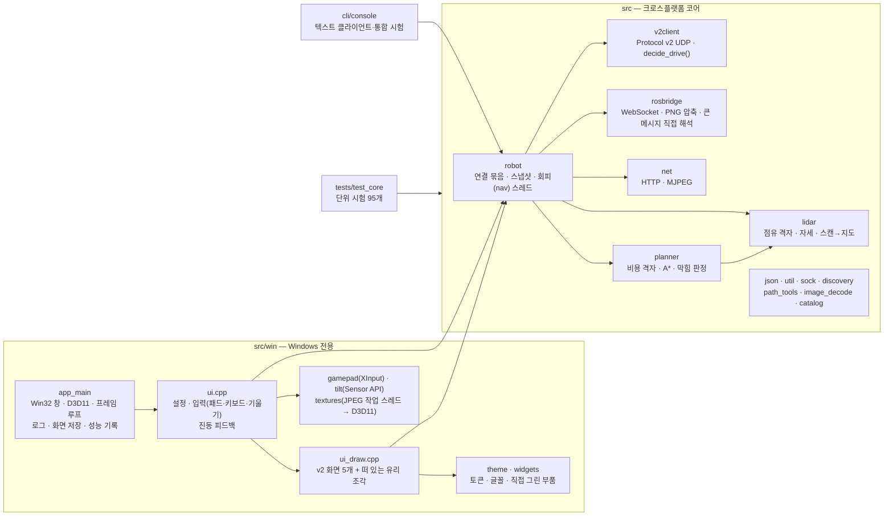
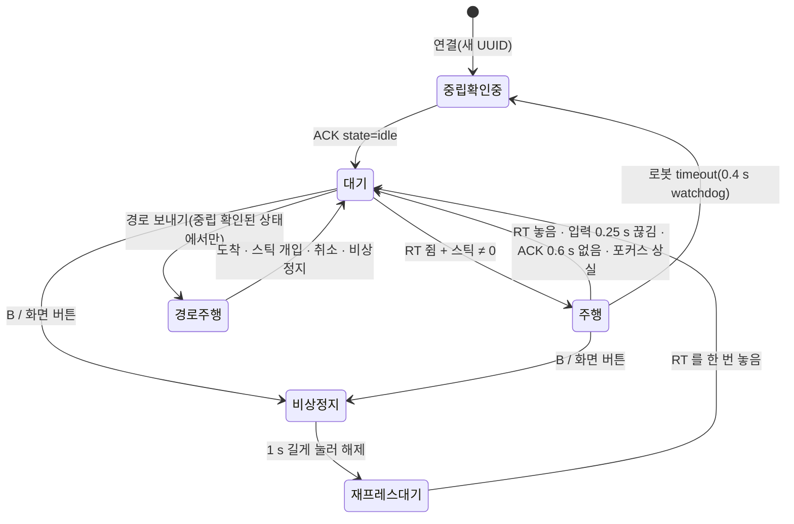
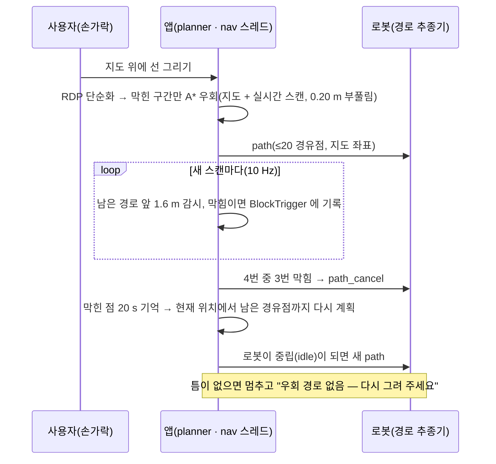

# 아키텍처

앱은 로봇의 공개 네트워크 인터페이스만 쓰는 **클라이언트**다(로봇 소프트웨어는 바꾸지 않는다). 코어는 운영체제와 무관하게 짜서 맥·리눅스에서 시험하고, 화면·패드·센서만 Windows(흑갈리) 전용이다.

## 1. 모듈

| 파일 | 하는 일 |
|---|---|
| `v2client.*` | 20 Hz `command` 송신, ACK 8필드 엄격 해석, RTT·유실 통계. 운전 허용은 순수 함수 `decide_drive()` 하나가 정한다 |
| `rosbridge.*` | RFC 6455 WebSocket 직접 구현(마스킹·조각·ping). 서비스 호출, 구독(throttle·`compression:"png"`), 발행. 끊기면 2 s 뒤 다시 연결하고 구독을 되살린다. 프레임·메시지 8 MiB 상한 |
| `lidar.*` | `/map` 600×600 정수 배열을 일반 JSON 해석기를 거치지 않고 직접 읽기, 쿼터니언 → yaw, 스캔 → 지도 좌표 |
| `planner.*` | 지도 점유 칸 + 실시간 스캔 점을 0.10 m 격자에 올리고 로봇 크기(0.20 m)만큼 부풀림(chamfer 거리 변환), 막힌 구간만 A*, 보이는 데까지 건너뛰어 ≤ 20점. `path_blocked_by()`, `BlockTrigger`(4번 중 3번 + 1.5 s 쿨다운), `remaining_goals()` |
| `robot.*` | 위 모듈을 한 로봇 연결로 묶는다. 화면은 `snapshot()` 을 프레임마다 한 번 복사해 읽기만 한다 |
| `ui.cpp` | 입력·안전 규칙(데드맨, 포커스 상실 중립, 큰 동작 두 번, 비상정지)과 진동. 그리기는 하지 않는다 |
| `ui_draw.cpp` | 화면 그리기만. 입력·안전 로직을 바꾸지 않는다 |

## 2. 스레드와 데이터 흐름

| 스레드 | 주기 | 하는 일 |
|---|---|---|
| UI | 120 Hz(vsync) | 패드 읽기 → `set_drive()`, 스냅샷 복사, 그리기, 텍스처 올리기. 프레임당 CPU 평균 0.6–1.2 ms(흑갈리 실측, `docs/MEASUREMENTS.md`) |
| v2 송신 | 20 Hz | `decide_drive()` → `command` 1개. 입력이 0.25 s 끊기거나 ACK 가 0.6 s 없으면 중립 |
| v2 수신 | 블로킹 | ACK → 상태·RTT·경로 요청 확인 |
| rosbridge 수신 | 이벤트 | `/map`(2 s, PNG) 해석, `/lidar_map/pose` 10 Hz + 지나온 길, `/scan` 10 Hz, 상태·중재기 |
| HTTP 폴링 | 1–4 Hz | `/api/path`(경로 중 4 Hz), `/api/map`(자세 대체용), `/api/status`(rosbridge 끊겼을 때) |
| 회피(nav) | 10 Hz | 아래 §4 |
| MJPEG 수신 + JPEG 풀기 | 스트림 | 최신 1장만 보관, 작업 스레드에서 풀고 UI 가 올린다 |
| 지도 텍스처 합성 | 새 `/map` 마다 | 점유 칸 + 블러 할로 RGBA 를 작업 스레드에서(UI 지연 없음) |
| 기울기 센서 | 30 Hz | Windows Sensor API 가속도계(있을 때만) |

## 3. 조종 세션 규칙(v2 클라이언트)

`decide_drive()` 의 입력은 (입력 신선함, 데드맨, 축 값, ACK 신선함, 로봇 상태, 비상정지, 재프레스 요구)이고, 출력은 (활성 명령 여부, 다음 재프레스 요구)다. 전이 표 전체가 단위 시험에 있다.

## 4. LiDAR 지도와 장애물 회피

로봇 경로 추종기의 안전 규칙(조이스틱 개입, watchdog·lease, 비상정지, 자세 튐, 센서 끊김 때 취소)은 그대로 살아 있고, 앱은 로봇이 경로를 취소하면 회피 주행을 끝낸다(자기가 보낸 취소만 예외).

## 5. 로봇 포트와 엔드포인트

| 포트 | 쓰임 |
|---|---|
| UDP 5001 | Protocol v2: `command` 20 Hz, `emergency_stop`, `clear_emergency`, `disconnect`, `path`, `path_cancel` |
| UDP 5002 | 로봇 찾기(`PUPPYPI_DISCOVER/1|nonce`) |
| TCP 9090 | rosbridge: `/puppy_control/go_home`·`pose`·`runActionGroup`·`emergency_stop`·`reset_estop`, `/lidar_mapper/save_map`·`reset_map`, 구독 `/map`·`/lidar_map/pose`·`/scan`·`status`·`arbiter_state`, `rosapi` |
| TCP 8080 | 카메라 MJPEG(`/usb_cam/image_raw`) |
| TCP 8090 | `/api/path`, `/api/map`, `/api/status` |

인증·암호화는 없다(로봇 쪽 설계). 같은 Wi-Fi 안에서만 쓴다.

## 6. 시험의 경계

- 단위 시험(`tests/test_core.cpp`, 95개): 파서, `decide_drive()`, 경로 단순화, 지도 좌표, LiDAR 해석, 계획기(우회·틈·막힘·지도 기반·감시 범위·막힘 판정·남은 경유점).
- 통합 시험(`tests/it_*.txt`, 콘솔 클라이언트 + `tools/mock_robot.py`): 가짜 로봇은 로봇 저장소의 프로토콜 모듈을 실행 시 불러와 규칙의 기준으로 쓰고, 방·상자·동적 장애물을 광선 투사로 흉내 낸다. 가짜 로봇 자체도 `tools/test_mock_robot.py`(12개)로 시험한다.
- CI(`.github/workflows/ci.yml`): 푸시·PR 마다 Ubuntu 24.04 에서 위 세 가지를 돌리고 Windows exe 를 교차 빌드한다.
- 가짜 로봇 통과는 실기 검증이 아니다. 실기는 `docs/HW_TEST_CHECKLIST.md`.

## 7. 빌드 산출물

| 항목 | 내용 |
|---|---|
| 형태 | MinGW-w64 정적 링크 단일 exe(의존 DLL 없음). 흑갈리에서는 폴더 안 GCC 16.2, 맥·CI 에서는 교차 빌드 |
| 보안 플래그 | `-fstack-protector-strong -D_FORTIFY_SOURCE=2 -Werror=format-security -fcf-protection=full`, 링크 `--dynamicbase --nxcompat --high-entropy-va` |
| 리소스(`src/win/app.rc`) | 아이콘(`app.ico`, `tools/make_icon.py` 로 생성), 버전 정보, 매니페스트(UTF-8 코드페이지, PerMonitorV2 DPI). 툴체인의 기본 매니페스트(`default-manifest.o`)는 빈 오브젝트로 가려 매니페스트가 하나만 남게 한다 |
| 함께 두는 파일 | `fonts\`(Pretendard Std). 없으면 맑은 고딕으로 대신 |
