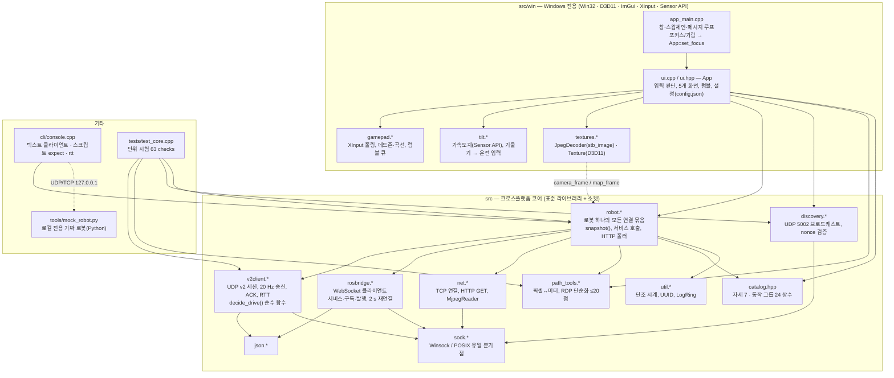
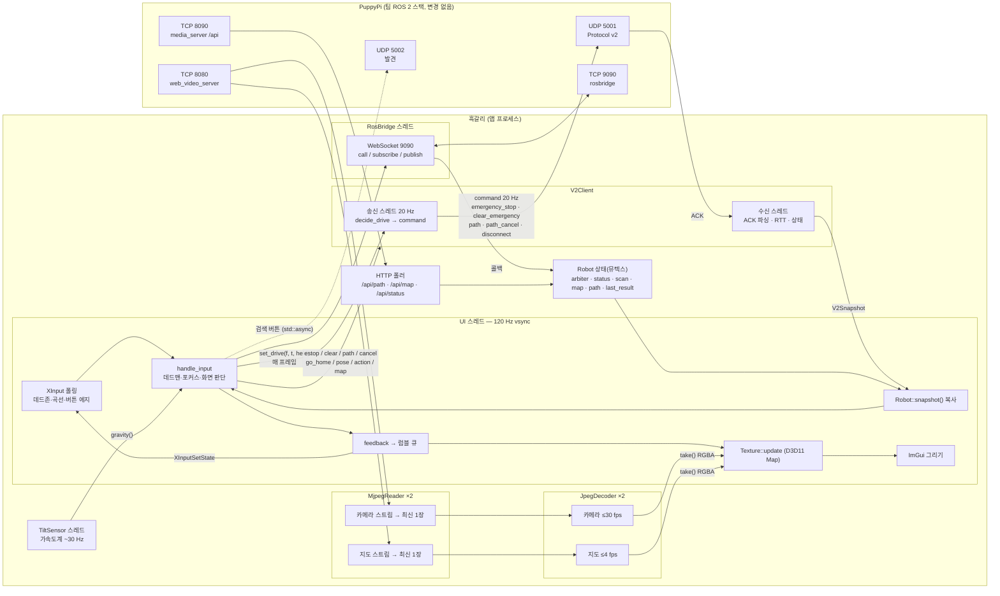
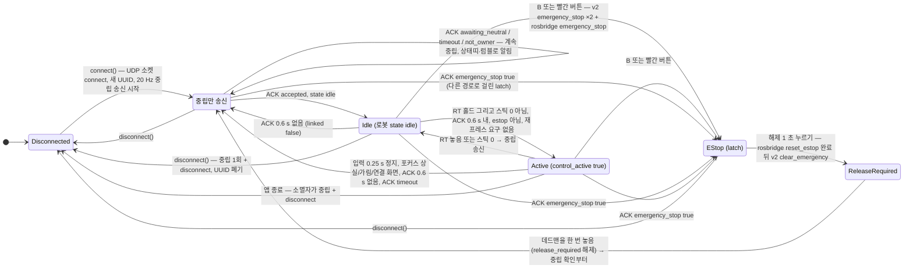
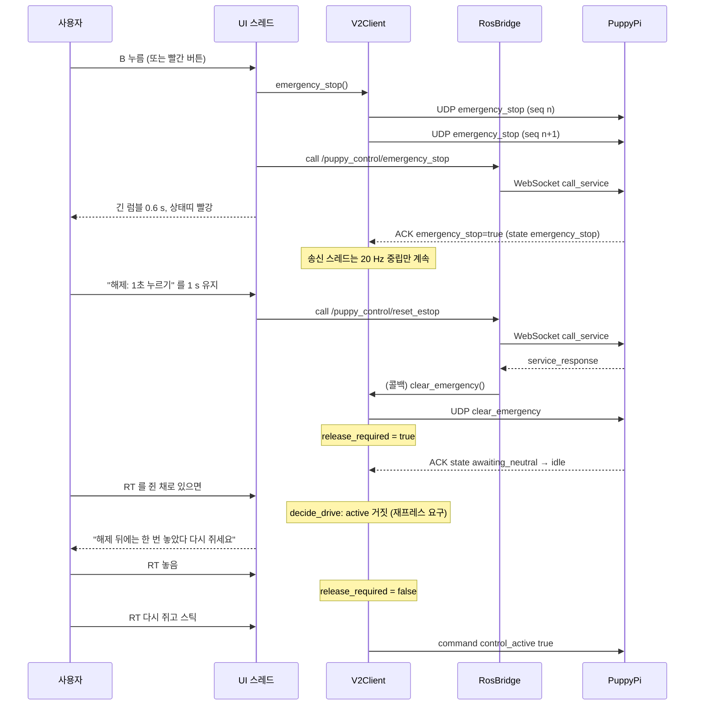

# 아키텍처

작성: 2026-11-14 | 기준: 현재 소스(`src/`, `src/win/`). 계획 문서(`PLAN_v1.md`)와 다른 곳은 코드를 따랐다.

앱은 **클라이언트 전용**이다. 로봇(Hiwonder PuppyPi, 팀 ROS 2 스택)이 이미 열어 둔 네 개의 네트워크 인터페이스만 쓰고, 로봇 소프트웨어는 바꾸지 않는다.

## 1. 모듈 지도



경계 규칙:

- `#ifdef _WIN32` 는 코어에서 `sock.hpp`(와 `util.hpp` 의 printf 포맷 속성, `v2client.cpp` 의 `SIO_UDP_CONNRESET`)에만 있다. 나머지 코어는 macOS clang 과 MinGW 에서 같은 소스로 빌드된다.
- UI 는 매 프레임 `Robot::snapshot()` 을 **한 번 복사**해 읽기만 한다. 로봇을 움직이는 요청은 `Robot`/`V2Client` 메서드 호출이고, 실제 패킷 송신은 v2 송신 스레드에서만 일어난다(비상정지·경로·disconnect 는 호출 스레드에서 같은 뮤텍스 아래 즉시 송신).
- `rosbridge`/HTTP/MJPEG 수신 콜백은 `Robot` 의 보호된 필드에만 쓰고 UI 를 직접 건드리지 않는다.

## 2. 스레드와 데이터 흐름

| 스레드 | 주기 | 하는 일 | 소스 |
|---|---|---|---|
| UI(메인) | vsync, 흑갈리 120 Hz | Win32 메시지, **XInput 폴링(`Gamepad::poll`)**, `Robot::snapshot()` 복사, `handle_input` → `V2Client::set_drive()`, 럼블, 디코더 결과를 D3D11 텍스처로 업로드, ImGui 그리기 | `app_main.cpp`, `ui.cpp`, `gamepad.cpp` |
| v2 송신 | **20 Hz**(50 ms, 밀리면 따라잡지 않음) | `decide_drive()` → `command` 1개 송신, 송신 시각 기록(RTT·유실용) | `v2client.cpp::sender_loop` |
| v2 수신 | 이벤트(recv 타임아웃 200 ms) | ACK 8필드 파싱, 이전 세션 client_id 무시, RTT(지수 평균), 상태 변화 로그 | `v2client.cpp::receiver_loop` |
| rosbridge | 이벤트 | WebSocket 핸드셰이크·프레이밍, 서비스 응답 매칭, 구독 콜백. 끊기면 2 s 뒤 재연결하고 구독·광고 복구 | `rosbridge.cpp::loop` |
| MJPEG 카메라 | 스트림 | `multipart/x-mixed-replace` 분리, **최신 1장만** 보관, fps 계산. 끊기면 2 s 뒤 재연결 | `net.cpp::MjpegReader` |
| MJPEG 지도 | 스트림 | 같음(`/lidar_map/image`) | `net.cpp::MjpegReader` |
| JPEG 디코더 카메라 | 새 번호일 때만, 최대 30 fps | stb_image → RGBA, 디코드 시간 측정 | `textures.cpp::JpegDecoder` |
| JPEG 디코더 지도 | 새 번호일 때만, 최대 4 fps | 같음 | `textures.cpp::JpegDecoder` |
| HTTP 폴러 | `/api/path` 1 Hz(이동 중 4 Hz), `/api/map` 1 Hz, `/api/status` 2 Hz(rosbridge 끊겼을 때만) | 경로 상태 전이 로그, 지도 기하, 중재기 대체원 | `robot.cpp::http_loop` |
| 기울기 센서 | 약 30 Hz(33 ms) | COM Sensor API 가속도계 읽기. 없으면 `available()==false` | `tilt.cpp::loop` |
| 발견(요청 시) | `std::async`, 1.5 s 수집 | 모든 IPv4 인터페이스 브로드캐스트 + 255.255.255.255 | `discovery.cpp`, `ui.cpp::draw_connect` |



시계: 모든 시각은 흑갈리 한 기기의 단조 시계(`now_s()`)다. RTT = 같은 `sequence` 의 `command` 송신 시각 → ACK 수신 시각. 로봇 시계와 동기화하지 않으므로 종단 지연(입력 → 다리 움직임)은 측정하지 않는다.

## 3. v2 클라이언트 상태 규칙

클라이언트는 자체 상태 머신을 들고 있지 않다. 로봇이 ACK 로 알려 주는 `state`(`awaiting_neutral` / `idle` / `active` / `timeout` / `emergency_stop` / `fault`)를 따라가고, 매 송신 주기마다 아래 입력을 모아 **순수 함수 `decide_drive()`** 가 "이번 주기에 활성 명령을 보낼지" 를 정한다(`src/v2client.cpp`, `tests/test_core.cpp` 의 `test_drive_decision`).

```text
want   = input_fresh(≤0.25 s) && held && (|forward| > 0 || |turn| > 0)
release_required' = want && release_required          // 입력을 놓으면 풀린다
ready  = state == "idle" || state == "active"
active = want && ack_fresh(≤0.6 s) && ready && !release_required' && !estop_requested && !ack_estop
```

`active` 가 거짓이면 중립 `control_active:false, forward:0, turn:0` 을 보낸다. 아래 다이어그램은 이 규칙과 ACK 상태를 합쳐 앱이 실제로 거치는 단계로 그린 것이다.



보조 규칙(코드 기준):

- **입력 신선도 0.25 s**: `set_drive()` 는 UI 스레드가 매 프레임 호출한다. 화면이 멈추면 송신 스레드는 입력을 오래된 것으로 보고 중립을 보낸다.
- **ACK 신선도 0.6 s**: 로봇 watchdog(0.4 s)이 먼저 멈춘 뒤 앱이 `linked=false` 로 바뀐다. 럼블 두 번.
- **포커스**: `WM_ACTIVATEAPP` 비활성, `WM_SIZE` 최소화, DXGI `OCCLUDED` 에서 `App::set_focus(false)` → 즉시 `set_drive(0,0,false)`. 가려진 동안에도 프레임 처리는 계속해 럼블·상태를 유지한다.
- **비상정지 송신**: `emergency_stop` 을 번호를 올려 두 번 보낸다(UDP 유실 대비). `estop_requested` 는 비상정지 뒤 번호의 ACK 가 latch 없이 돌아오면 지운다.
- **해제 순서**: rosbridge 가 연결돼 있으면 `/puppy_control/reset_estop` 완료 콜백에서 `clear_emergency` 를 보낸다. 끊겨 있으면 v2 만 해제한다.
- **경로**: `send_path` 는 마지막 ACK 상태가 `idle` 일 때만 보낸다(`active` 면 "운전 입력을 놓은 뒤 다시 시도"). 경로 진행 중 스틱을 쓰면 로봇 규칙에 따라 취소되고, `/api/path` 폴링이 `cancelled` 를 보여 준다. X 또는 버튼은 `path_cancel` 을 보낸다.
- **세션**: UDP 소켓을 `connect()` 해 로봇 주소에서 온 데이터그램만 받고, 이전 세션 UUID 의 늦은 ACK 는 버린다. `disconnect` 한 UUID 는 로봇이 다시 받지 않으므로 `stop()` 뒤 새 UUID 를 만든다. Windows 에서는 `SIO_UDP_CONNRESET` 을 꺼 로봇이 꺼졌을 때의 ICMP 로 recv 가 깨지지 않게 한다.
- **유실률**: 최근 100개 `command` 중 1 s 넘게 ACK 가 없는 것의 비율.
- 구현하지 않은 것: `out_of_order` 자동 재동기화, ACK 장기 부재 시 소켓 재생성(계획 문서에는 있었음). 현재는 표시와 "연결 끊기 → 연결" 로 대응한다.

### 비상정지 → 해제 → 재프레스 순서



## 4. 로봇 포트와 엔드포인트

모두 팀 ROS 2 스택이 이미 제공하는 인터페이스다. 앱 쪽 상수는 `src/robot.cpp` 상단과 `src/discovery.hpp`, `src/v2client.hpp` 에 있다.

| 전송 | 포트 | 용도 | 앱이 쓰는 메시지·경로 |
|---|---|---|---|
| UDP | **5001** | PuppyPi Protocol v2 조종 | `command`(20 Hz, `control_active`·`forward`·`turn` −1..1), `emergency_stop`, `clear_emergency`, `path`(1~20점, 지도 좌표 m, ±100 m), `path_cancel`, `disconnect`. 응답은 8필드 ACK: `protocol, type, client_id, sequence, accepted, reason, emergency_stop, state` |
| UDP | **5002** | 발견 | 송신 `PUPPYPI_DISCOVER/1\|<nonce 32hex>` → 수신 `PUPPYPI_HERE/1\|<nonce>\|<id 32hex>\|<이름 URL 인코딩>\|<조종 포트>\|2`. nonce 가 다르면 버림 |
| TCP | **9090** | rosbridge v2 (WebSocket) | 서비스: `/puppy_control/go_home` (std_srvs/Empty), `/puppy_control/runActionGroup` (puppy_control/SetRunActionName, `name`=`<이름>.d6ac`, `wait`=false), `/puppy_control/emergency_stop`·`/puppy_control/reset_estop`·`/lidar_mapper/save_map`·`/lidar_mapper/reset_map` (std_srvs/Trigger), `/rosapi/topics`. 발행: `/puppy_control/pose` (puppy_control/Pose: roll/pitch/yaw rad, height/x_shift/stance_x/stance_y cm, run_time ms). 구독: `/puppy_control/arbiter_state`·`/puppy_control/status` (std_msgs/String, JSON 문자열), `/scan` (sensor_msgs/LaserScan, throttle 200 ms) |
| TCP | **8080** | web_video_server MJPEG | `/stream?topic=/usb_cam/image_raw&type=ros_compressed`(카메라), `/stream?topic=/lidar_map/image&type=ros_compressed`(지도) |
| TCP | **8090** | media_server JSON | `/api/map`(`width_px, height_px, left_m, bottom_m, px_per_m, image_seq, age_s, robot{x_m,y_m,yaw_rad}`; 503 = 아직 지도 없음), `/api/path`(`state, reason, request_client_id, request_sequence, points, index, count, remaining_m, elapsed_s`), `/api/status`(`arbiter` 등) |

지도 좌표 변환(`/api/map`, 팀 로봇 문서 18 §4): `u = (x − left_m) · px_per_m`, `v = height_px − (y − bottom_m) · px_per_m`. 지도 프레임은 +x 앞, +y 왼쪽, 단위 m.

로봇 쪽 규칙 중 앱 설계에 직접 영향을 준 것(팀 로봇 문서 06): 단일 조종자(UUID + 주소, lease 1.0 s), watchdog 0.4 s, 활성 명령 전 중립 확인, 비상정지 latch 는 조종자만 해제, `disconnect` 한 UUID 재사용 불가, 속도 상한 전진 25 cm/s·후진 5 cm/s·회전 0.28 rad/s(앱의 "최고 속도 비율" 1.00 이 이 상한).

## 5. 시험 도구와 경계

- `cli/console.cpp`: 같은 코어로 로봇(또는 가짜 로봇)을 다루는 텍스트 클라이언트. `--script` 로 `expect v2|path|estop|result` 를 검사하고 실패 시 종료 코드 1. `rtt <초>` 는 지정 시간 동안 RTT 표본을 모아 중앙값·p95·최대를 출력한다.
- `tools/mock_robot.py`: Python 표준 라이브러리로 UDP 5001/5002, TCP 8080/8090/9090 을 127.0.0.1 에 연다. **실행 시 `--robot-src` 의 별도 작업 사본에서 팀 모듈(`protocol_v2.py`, `path_follower.py`, `discovery.py`)을 import** 하므로 로컬 전용이며, 저장소 공개 전에는 `PLAN_v1.md` §5.2 의 스펙 기준 재구현으로 바꿔야 한다. 가짜 로봇 통과는 실기 검증이 아니다.
- 실기 검증은 `HW_TEST_CHECKLIST.md` 로 사용자가 수행하고, 측정값은 조건·표본 수와 함께 `MEASUREMENTS.md`(미작성)에 적는다.
